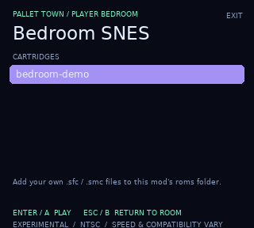
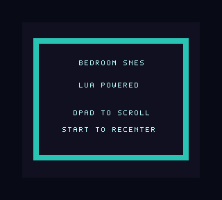
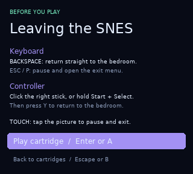

# Bedroom SNES

A **pure-Lua SNES emulator inside Gen1Recomp**, opened by interacting with the SNES in the player's upstairs bedroom in Pallet Town. Supports Pokémon Red, Blue, and Yellow.

**v0.2.1 is an experimental preview.** The included original homebrew cartridge boots and responds to controls. Speed and game compatibility vary; this is not a full-speed, broadly compatible replacement for a standalone emulator. No commercial SNES ROMs are included.




## Install and play

1. Download `Bedroom-SNES-v0.2.1.zip` from [Releases](https://github.com/Bentley734/Bedroom-SNES/releases/latest).
2. Import it using Gen1Recomp's mod manager and enable **Bedroom SNES** for Red, Blue, or Yellow. Gen1Recomp **0.3.54 or newer** is required; native loader/graphics tests cover 0.3.54 and 0.3.95.
3. Go upstairs in the player's house in Pallet Town and interact with the SNES. Select **bedroom-demo** to try the included cartridge.
4. Read the exit instructions shown **before every cartridge launch**, release the launch button, then confirm to play.
5. Press **Backspace** to return straight to the bedroom, or **Escape/P** to open the pause menu. Controller pause and exit controls also work.



### Add your own cartridges

Copy your own uncompressed `.sfc` or `.smc` files into the installed mod's **`roms/` directory**, next to `bedroom-demo.sfc`. Reopen the cartridge menu (or press R in it) to refresh the list. The mod reads only its own folder. Depending on the platform, use the app's file-sharing tools or add the files to the ZIP before importing it. This preview does not provide a system file picker or download games.

Accepted cartridges: standard **NTSC LoROM and HiROM**, 32 KiB–4 MiB in power-of-two sizes, with or without a 512-byte copier header. Enhancement-chip cartridges and PAL cartridges are rejected with an explanation. Header validation cannot establish that an entire cartridge is valid or compatible.

## Controls

SNES keyboard controls apply while a cartridge is playing; the normal Pokémon controls resume on exit.

| SNES control | Keyboard | SDL gamepad |
|---|---|---|
| D-pad | Arrow keys | D-pad / left stick |
| B / A | Z / X | B / A |
| Y / X | A / S | Y / X |
| L / R | Q / E | Left / right shoulder |
| Start | Enter | Start |
| Select | Shift / Tab | Back / Select |
| Pause | Escape / P | Right-stick click, or hold Start + Select |
| Return straight to bedroom | Backspace | Pause, then Y |

Gameplay has no on-screen controls or HUD. Tap/click the picture to open the pause menu. Use a keyboard or controller to play. In that menu: Enter/A resumes, Q/B opens the cartridge menu, Backspace/Y returns to the bedroom, R resets the cartridge, and M toggles sound. The demo uses the D-pad to scroll its picture and Start to recenter it.

If a session stays below **20 emulated FPS** for three consecutive two-second measurement windows after the warm-up windows, the player comments on returning to the bedroom: **“I think there's something wrong with my SNES...”** Pauses and launch/loading time are excluded. Normal performance and brief slowdowns do not trigger the line.

Battery-backed cartridge RAM saves automatically about every 30 seconds of active screen time and on pause/exit. Saves use Gen1Recomp's per-mod storage, scoped to the Pokémon game and playthrough, with the cartridge's SHA-256 as its key. Renaming an identical cartridge does not create a different save. Reset preserves cartridge RAM. **Save states are not implemented.**

## Compatibility and performance

- The core is adapted from [SnesJs](https://github.com/angelo-wf/SnesJs), commit `b904fdb63be15dc0470b69091622ba5b1bde7275`, under the MIT license. It is not a port of Snes9x or ZSNES.
- Includes the 65816 CPU, scanline PPU, SPC700, partial DSP audio, DMA/HDMA, one controller, LoROM/HiROM mapping, and battery RAM.
- Inherits SnesJs' incomplete CPU emulation-mode behavior, approximate timing, graphics edge cases and missing DSP echo. Enhancement chips, PAL timing, high-resolution interlace output, save states and multiplayer are outside this preview.
- One field of interlaced video is shown at a time. Horizontal hires pixels are retained. Some effects will render incorrectly.
- The emulator shares a bounded work allowance with the host and catches up small frame delays. **Super Mario World (USA)** sustained **60.0 FPS** (900 frames / 15.0006 seconds) in a native paced first-level test with movement, jumping, graphics and audio. **Super Mario All-Stars (USA), Super Mario Bros. 1 World 1-1**, measured **58.4 FPS** (876 frames / 15.0080 seconds). Uncapped native tests measured roughly 66–72 FPS for Mario World and 65–66 FPS for All-Stars. **Yoshi's Island (USA, Rev 1) is unsupported** because it requires Super FX. These are short local Windows measurements, not full-game or other-platform guarantees; inherited SnesJs accuracy limits still apply. See `docs/mario-validation.json` for complete evidence. The earlier Zombies measurements in `docs/rom-validation.json` describe v0.1.1; v0.2.0 also passes its 18 reference checkpoints.
- Uses Lua 5.1-compatible source, LÖVE graphics/audio and the standard `bit` library when available. An arithmetic bit fallback exists. No FFI, native emulator binary, external emulator process, network access or platform-specific emulator dependency is used. Windows was tested; other platforms are unverified.
- The `engine_internals` permission is used for the engine music and touch-overlay integration. The mod composes the bedroom's map-script interaction and owns a normal game state while playing.

## Validation and development

`tests/run.py` covers original-demo boot/input, cartridge validation, SRAM, 1,776 PPU scanlines (including windows, subscreen math and size-one mosaic), 1,664 sprite scanlines, 60 scheduler frames, 1,728 partial scheduler/state comparisons, frame pacing, and the complete 534-sample stereo audio queue. `tests/differential.py` checks both reference and optimized CPU/SPC dispatch against all 2,048 opcode/flag cases, six full machine/frame snapshots and 512 audible stereo DSP samples. Private-ROM runs render every frame and match 21 Mario World, 23 All-Stars and 18 Zombies checkpoints for image hashes, CPU/SPC positions and audio peaks. These establish agreement with SnesJs, not physical-hardware accuracy.

`tests/love_main.lua` exercises the production mod loader and sandbox, bedroom MapScripts, native graphics/audio, raw input capture, tap-to-pause and resized pointer routing, pause/resume, repeat entry/exit, storage, save-failure handling and restoration of normal input/touch controls. Native fixtures do not launch a user's save file.

Developer dependencies: Python with `lupa` (LuaJIT backend), Node.js for the differential oracle, and a LÖVE 11.x runtime plus Gen1Recomp sources/test fixtures for the native test. `tests/prepare_love.py` documents this workspace's isolated probe setup. Run from the repository root:

```text
python tests/run.py
python tests/differential.py
python tests/benchmark.py
```

The checked-in Lua core is the runtime source. Rebuild it with Python `esprima==4.0.1` and the exact upstream checkout:

```text
python tools/port_core.py /path/to/SnesJs
python tools/build_demo.py
python tools/package_release.py
```

The source translator intentionally handles only this core's JavaScript subset and fails on unsupported syntax. It preserves 32-bit bitwise semantics, typed-array wrapping, zero-based indexing, switch fallthrough, default arguments and JavaScript truthiness. Numeric bit operands use LuaJIT's standard bit functions directly; source expressions requiring boolean coercion or truncation keep explicit conversions. Explicit typed writes, multiple color/address return values and a tested batched Mode 1 renderer reduce Lua overhead. CPU, DMA and HDMA countdowns stop at PPU/IRQ/refresh event boundaries. The hot clock and sprite loops use direct Lua dispatch. SPC faults propagate to the frontend's error screen instead of being silently swallowed.

See [THIRD_PARTY.txt](THIRD_PARTY.txt) and [LICENSE](LICENSE). The original demo source and generated cartridge are also MIT-licensed.

The optimized Mode 1 renderer packs tile bitplanes once per tile row, resolves background/sprite priority with reusable buffers, and supports window masks, clipping, fixed-color and main/subscreen math. Size-one mosaic stays on this path because it changes no pixels. Other modes, larger mosaic and hires use the reference renderer. Palette conversion is refreshed every scanline; sprite overflow and interlace behavior remain reference-compatible. No Snes9x-Z code was copied; batching and redundant-work removal inspired the optimization. The mod remains single-threaded with no new permissions.

The SNES state opts out of Pokemon speed multipliers. Audio queues all 534 stereo samples per 60 Hz frame and buffers two frames before playback to absorb ordinary timing jitter. Low-performance devices can still stutter; this does not add the upstream core's missing DSP echo.

## Full-color window presentation

v0.2.1 presents the cartridge and menus through the engine composition hook, preserving their RGB colors independently of Pokemon palettes and post-processing. Gameplay uses the largest centered integer scale that fits the window in physical pixels, with nearest-neighbor filtering and black borders. Standard 256-pixel SNES output, horizontal hires and overscan keep their source dimensions. Very small windows that cannot fit even 1x use a reduced fit. There is no on-screen pad, FPS label or pause label. Escape/P pauses, Backspace exits immediately, and tapping/clicking opens the pause menu. The launch instructions still explain exit controls.

Native presentation tests run the real Renderer:endFrame path with forced palettes and an enabled shader path. They check unchanged cartridge RGB, identical menu colors across palette modes, three window sizes, DPI-aware integer placement and resized pause-menu input.
